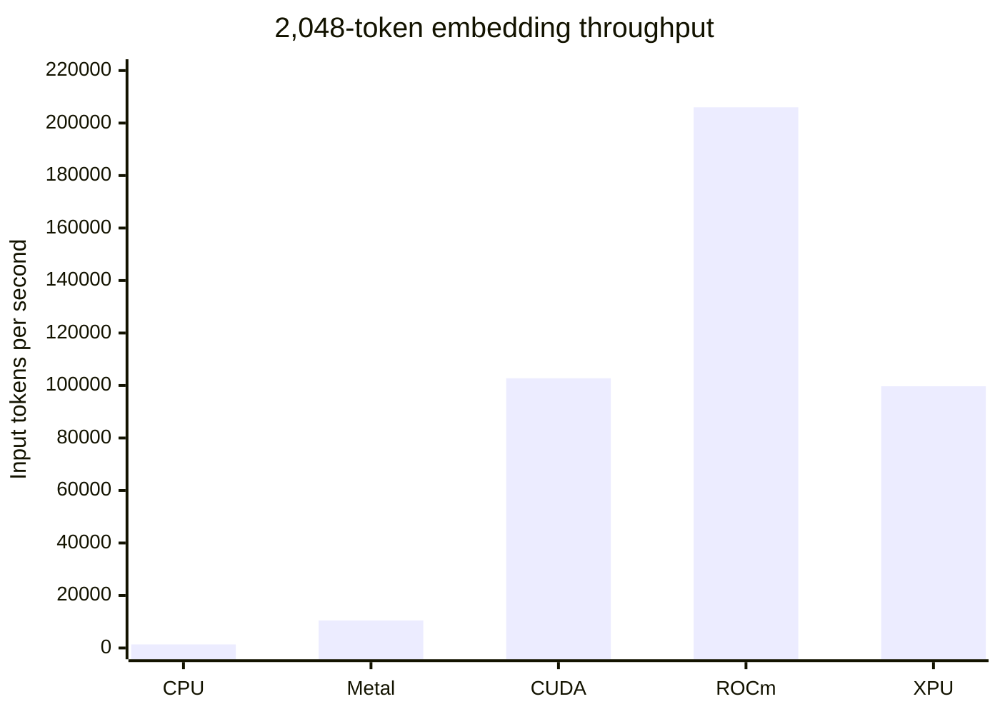

# embeddinggemma.c

**The fastest way to serve EmbeddingGemma. Anywhere.**

Powered by QuixiCore Kernels 

https://github.com/QuixiAI/QuixiCore

https://github.com/QuixiAI/QuixiCore-Metal

`embeddinggemma` is a tiny, model-specialized embeddings server for
EmbeddingGemma 2 and EmbeddingGemma 300M. The default `embeddinggemma-2` profile
embeds text, images, audio, sampled video frames, and combinations of these
with standalone native CPU and Metal inference. The original `embeddinggemma-300m` profile retains
its CPU, Apple Metal, NVIDIA CUDA, AMD ROCm, and Intel XPU SYCL backends.
Neither profile links llama.cpp or ggml.

EmbeddingGemma 2 has separate native text, vision, and audio graphs. The Metal
build selects Metal by default and keeps learned inference on the GPU. Image
decoding/resizing and WAV/mel preprocessing run on the CPU. CUDA, ROCm, and XPU
support for the new profile is still pending.

- Hand-tuned inference kernels for every supported accelerator family.
- Dynamic batching, bounded queues, duplicate singleflight, and exact-result
  caching for concurrent serving.
- Matryoshka embeddings at 768, 512, 256, and 128 dimensions.
- Automatic model download and a built-in HTTP server on port `42666`.

## EmbeddingGemma 300M performance

Measured over HTTP against llama.cpp build b8981 (`llama-server`, Metal) on
an Apple M5 Max: identical GGUF, exact token counts, 768-float outputs, all
caches disabled, both servers restarted fresh for every cell. embeddinggemma
delivers more embeddings per second in **all 54 cells** — geometric mean
**1.25x**, up to 2.01x:

| tokens \ concurrency | 1 | 2 | 4 | 8 | 16 | 32 |
|---:|---:|---:|---:|---:|---:|---:|
| 8 | 1.20x | 1.44x | 1.40x | 1.28x | 1.33x | 1.42x |
| 16 | 1.69x | 2.01x | 1.65x | 1.37x | 1.31x | 1.35x |
| 32 | 1.22x | 1.73x | 1.33x | 1.23x | 1.19x | 1.23x |
| 64 | 1.18x | 1.49x | 1.28x | 1.21x | 1.20x | 1.14x |
| 128 | 1.01x | 1.36x | 1.16x | 1.11x | 1.12x | 1.03x |
| 256 | 1.05x | 1.31x | 1.14x | 1.15x | 1.09x | 1.15x |
| 512 | 1.16x | 1.28x | 1.16x | 1.03x | 1.48x | 1.05x |
| 1,024 | 1.39x | 1.09x | 1.41x | 1.07x | 1.48x | 1.03x |
| 2,048 | 1.39x | 1.05x | 1.40x | 1.02x | 1.44x | 1.04x |

Reproduce with `make perf-compare-llamacpp`; methodology and raw results are
documented in [`perf/`](perf/).

## Basic Usage

Start the server with the default EmbeddingGemma 2 profile:

```sh
embeddinggemma
```

On this Mac, build and run the native Metal server:

```sh
make metal
./build/embeddinggemma-metal
```

EmbeddingGemma 2 serves with a batched stack by default: weight-stationary
GEMVs and fused layers for short waves, and on Metal 4 GPUs tensor-op GEMMs and
flash attention for wide packed waves (validated on the M5 Max; route parity
>= 0.9999 against the reference graph). The CPU build uses a packed-batch
graph with NEON/i8mm kernels. Each route can be turned off, e.g.
`EI_GEMMA2_METAL_TENSOR2=0`; `CONTRIBUTING.md` lists every switch.

The text model and combined vision/audio projector are downloaded on first run to
`${XDG_CACHE_HOME:-$HOME/.cache}/embeddinggemma.c/`.

Create an embedding:

```sh
curl -sS http://127.0.0.1:42666/api/embed \
  -H 'Content-Type: application/json' \
  -d '{
    "model": "embeddinggemma-2",
    "input": ["task: search result | query: what powers the cell"],
    "dimensions": 256
  }'
```

The response is:

```json
{"embeddings":[[0.0123,-0.0456]]}
```

An additive OpenAI-compatible endpoint is available for gateways and existing
SDKs. The original `/api/embed` contract remains supported:

```sh
curl -sS http://127.0.0.1:42666/v1/embeddings \
  -H 'Content-Type: application/json' \
  -d '{
    "model": "embeddinggemma-2",
    "input": ["task: search result | query: what powers the cell"],
    "dimensions": 256
  }'
```

The OpenAI response contains the standard `object`, `data`, `model`, and
`usage` fields. The requested model name is echoed so a gateway can use a
stable alias, and `usage` reports the exact number of tokens processed.

`input` accepts one string or an array of strings. Text is embedded exactly as
provided, so include the model's task prefix yourself (prefixes apply to text
only; pass images, audio, and video without one):

| Use case | Query | Document |
|---|---|---|
| Search | `task: search result \| query: {query}` | `title: {title} \| text: {content}` |
| Question answering | `task: question answering \| query: {question}` | `title: {title} \| text: {passage}` |
| Fact checking | `task: fact checking \| query: {claim}` | `title: {title} \| text: {evidence}` |
| Code search | `task: code retrieval \| query: {query}` | `title: {title or filename} \| text: {code}` |
| Classification | `task: classification \| query: {content}` | — |
| Clustering | `task: clustering \| query: {content}` | — |
| Similarity | `task: sentence similarity \| query: {content}` | — |

Use `title: none` when a document has no title. `dimensions` is optional and
may be `768`, `512`, `256`, or `128`; the default is `768`. Reduced Matryoshka
embeddings are normalized again before being returned (the model card reports
near-lossless quality down to 256; 128 loses noticeably on multimodal input).
Input longer than the context (8,192 tokens for `embeddinggemma-2`, 2,048 for
`embeddinggemma-300m`) is truncated, keeping the final end-of-sequence token;
`usage` reports the tokens actually embedded. Set
`"encoding_format":"base64"` to receive packed little-endian float32 data
instead of JSON float arrays.

Open [http://127.0.0.1:42666/docs](http://127.0.0.1:42666/docs) for the embedded
API reference. `GET /healthz` reports readiness, and `--bind`, `--port`, and
`--model` override the listening address, canonical port, and model path.

## Model profiles and multimodal input

| Profile | Weights | Modalities | Backend |
|---|---|---|---|
| `embeddinggemma-2` (default) | `embeddinggemma-2-Q8_0.gguf` + `mmproj-embeddinggemma-2-Q8_0.gguf` | text, image, audio, video frames, mixed | CPU, Metal, CUDA |
| `embeddinggemma-300m` | `embeddinggemma-300M-qat-Q4_0.gguf` | text | CPU, Metal, CUDA, ROCm, XPU |

```sh
make
./build/embeddinggemma
# Use existing files; the projector defaults to a sibling of the text model:
./build/embeddinggemma --model model/embeddinggemma-2-Q8_0.gguf \
  --mmproj model/mmproj-embeddinggemma-2-Q8_0.gguf
# Original accelerator profile:
./build/embeddinggemma-metal --profile embeddinggemma-300m
```

`--profile` selects a startup profile, not a per-request model router. An explicit
existing `--model` or `EI_MODEL_PATH` is identified by GGUF architecture for
compatibility with older scripts. An explicit conflicting `--profile` fails.
Profile 2 runs on CPU, Metal, and CUDA (ROCm/XPU requests fail clearly). It has
an 8,192-token context shared by every part of an input; the original retains
2,048 tokens.
Switching profiles changes embedding coordinates: rebuild existing indexes.

Both embedding endpoints accept a content object as one input, or an array
mixing strings and content objects. Parts are processed in order and produce
one shared embedding per input object:

```json
{
  "model": "embeddinggemma-2",
  "input": {
    "content": [
      {"type": "text", "text": "An image and its soundtrack: "},
      {"type": "image", "data": "BASE64_IMAGE"},
      {"type": "audio", "data": "BASE64_WAV"},
      {"type": "video", "frames": ["BASE64_FRAME_0", "BASE64_FRAME_1"], "fps": 1}
    ]
  },
  "dimensions": 768
}
```

- Images: PNG, JPEG, BMP, or PNM, encoded as base64 or a base64 data URL.
  Images are resized with bicubic filtering and encoded at up to 280 soft tokens;
  video frames use a 140-token budget. Set `"vision_tokens"` (70–1120) on an
  image or video part to trade latency for detail. Small inputs are enlarged to
  the model's minimum vision budget. Decoded images are limited to 16 megapixels.
- Audio: mono 16 kHz PCM16 or float32 WAV, at least 21 ms, at 25 tokens per
  second. The native frontend computes the model's log-mel features and encodes
  30-second chunks.
- Video: provide sampled frames in temporal order, normally at one frame per
  second. `fps` describes the supplied frame sampling rate (default 1); timestamp
  text is inserted before each frame. Container decoding (MP4/WebM) and frame
  extraction happen in the client. On Metal, same-sized frames run the vision
  tower as one packed wave. Frames past the 114th are ignored (114
  frames at the 70-token minimum fill the context).
- Context: text, media soft tokens, media delimiters, and the begin/end tokens
  share 8,192 tokens. When an input runs out of room, text is cut off, an image
  or frame is encoded at the largest budget that still fits (or dropped below
  70 tokens), and audio is trimmed to the remaining seconds. Requests are never
  rejected for length.
- The HTTP body limit is 16 MiB. Content accepts at most 256 parts. Media URLs
  and local filesystem paths are not fetched by the server.

Text-only requests keep the batching/singleflight/persistent-cache path. Media
requests use the bounded HTTP response cache; token-ID caching cannot represent
their media content. The original profile rejects structured media input.

Validation: `make test` covers the original profile; `make test-gemma2` checks
exact new-tokenizer IDs, text/vision/audio reference parity, and HTTP modalities,
combined inputs, dimensions, concurrency, and truncation at the context limit.

The model card says not to run EmbeddingGemma 2 in float16 because its
activations exceed float16's range. This server keeps the residual stream,
norms, softmax, and every accumulation in float32; float16 appears only as
matrix and attention operands on Metal and CUDA. Measured operand magnitudes
stay below 740 across text, vision, and audio (float16 overflows at 65,504),
and the GPU paths match the float32 CPU reference (cosine ≥ 0.999).

## Using every core and GPU

`embeddinggemma-2` runs each batch ("wave") on an executor: a GPU pipeline slot
or a CPU worker with its own thread pool. Waves on different executors run at
the same time; the scheduler sends each new wave to an idle device first.

```sh
# CPU-only server with 128 cores: several independent workers beat one big pool
./build/embeddinggemma --threads 128 --cpu-workers 8
# Every CUDA GPU in the box, two waves in flight on each
./build/embeddinggemma-cuda --cuda-devices all --pipeline-slots 2
# GPUs plus the spare CPU cores as overflow capacity
./build/embeddinggemma-cuda --cuda-devices all --cpu-workers 2 --threads 64
```

- `--threads N` sets the CPU inference threads (default: every core up to 32
  for a single pool, every core with `--cpu-workers`); it overrides `EI_THREADS`.
- `--cpu-workers N` splits those threads into N workers. One wave stops
  scaling at around 64 threads and slows down past that, so give each worker
  16–32 threads. On 256 EPYC cores, 16 workers of 16 threads served 3.75× the
  short requests of the best single pool. On Linux each worker is pinned to its
  own cores, grouped by shared L3 cache (`--cpu-pin off` disables this). `--cpu-max-batch-tokens` (default
  1024) caps a CPU wave so the queue spreads across workers.
- `--cuda-devices all|0,1,...` loads the weights on each listed GPU.
  `--pipeline-slots` applies to every GPU.
- `--media-slots N` (default 2) sets how many image/audio/video requests run
  their towers on the GPU at once; each slot is a separate context, so media
  never waits on the text waves. On Metal the final text pass of concurrent
  media requests is packed into one wave.
- `--media-cache-mb N` (default 256, 0 disables) caches image, video-frame and
  audio tower outputs by content and whole content objects by their JSON, so
  a repeated image or clip skips decode and the tower (image768 47 -> 13 ms).
- Beside a GPU, CPU workers are overflow capacity. They start a wave only when
  every GPU slot is busy and more work is queued than the GPUs' next waves can
  absorb. They take only requests up to `--cpu-max-sequence-tokens` (default
  512) from that backlog. A CPU wave takes 10–100× longer than a GPU wave, so
  overflow trades tail latency for throughput. It adds little beside a fast GPU:
  a 16-core host added nothing to an RTX 5090. CPU and GPU embeddings of the
  same text agree to cosine ≥ 0.9996.
- The HTTP worker count caps the number of requests in flight. Unless
  `--workers` is given, it grows to 32 per executor.

## Install

Install the latest release as `~/.local/bin/embeddinggemma`:

```sh
curl -fsSL https://raw.githubusercontent.com/QuixiAI/embeddinggemma.c/main/install.sh | sh
```

The installer detects the host and selects Metal on Apple Silicon or CUDA,
ROCm, XPU, or CPU on Linux x86_64. It verifies the release checksum before
replacing an existing installation and falls back to CPU when an accelerator
runtime is unavailable.

Pin a release, backend, or installation directory when needed:

```sh
./install.sh --version v0.3.1
./install.sh --variant cpu
./install.sh --install-dir "$HOME/bin"
```

Published executables are deliberately small. Release `v0.3.1` contains:

| platform | backend | executable size |
|---|---|---:|
| macOS ARM64 | CPU | 139 KiB |
| macOS ARM64 | Metal | 497 KiB |
| Linux x86_64 | CPU | 106 KiB |
| Linux x86_64 | CUDA | 8.7 MiB |
| Linux x86_64 | ROCm | 1.2 MiB |
| Linux x86_64 | XPU SYCL | 2.1 MiB |

### Fork CI binaries

This fork's `CI` workflow uploads checksummed CPU executable artifacts for
Linux x86_64, Linux ARM64, macOS ARM64, and Windows x86_64 after unit, model,
and HTTP conformance checks pass. Download artifacts from the workflow run;
these are CI builds, not upstream release assets. Existing CUDA, ROCm, XPU
and Metal release targets remain available through the upstream build process.

CPU builds use the compiler's baseline architecture, without `-march=native`:
x86_64 uses SSE2 and ARM64 uses NEON. Linux artifacts are built on Ubuntu 24.04
and require a compatible glibc (2.39 or later); macOS ARM64 targets macOS 14 or
later. Windows uses a native MinGW UCRT64 executable with statically linked
winpthreads and compiler runtime, tested on Windows Server 2022. It requires
Windows' Universal C Runtime; older Windows versions are not CI-tested.
No Windows GPU backend or PowerShell installer is provided by this change.

On Windows, run `embeddinggemma-windows-x86_64-cpu.exe`. The default model
cache is `%LOCALAPPDATA%/embeddinggemma.c/`, falling back to
`%USERPROFILE%/.cache/embeddinggemma.c/`; `XDG_CACHE_HOME`, `EI_MODEL_PATH`, and
`--model` retain their existing precedence. Automatic download uses native
`curl.exe` or `wget.exe` on PATH and supports paths containing spaces.
Build locally from an MSYS2 UCRT64 shell with `make check`,
`make test-windows-download`, and `make test` after supplying the public model.
The model's Gemma license is separate from this repository's MIT license.

The 278 MB Q4_0 model is downloaded separately from Hugging Face and is not
distributed by this project.

## Performance

These are warmed median measurements of the complete 300M Q4_0 inference
engine, including token embedding through final pooling and normalization.
They are absolute results from the listed machines, not normalized same-device
backend comparisons.

| backend | tested hardware | 1-token req/s | 32-token tok/s | 2,048-token tok/s |
|---|---|---:|---:|---:|
| CPU | Apple M5 Max | 370 | 1,051 | 1,350 |
| Metal | Apple M5 Max | 570 | 8,009 | 10,465 |
| CUDA | NVIDIA RTX 3090 | 584 | 13,897 | 102,755 |
| ROCm | AMD Instinct MI300X | 1,072 | 8,890 | 206,011 |
| XPU SYCL | Intel Arc Pro B60 | 962 | 14,747 | 99,708 |

At 32-token concurrency, the production scheduler reaches 3,279 req/s on an
RTX 3090, 3,952 req/s on an MI300X, and 3,411 req/s in an explicit batch on an
Arc Pro B60. The MI300X reaches 26,014 req/s for a packed batch of 72 one-token
requests. Long-context throughput peaks at 206,011 input tokens/s.



A same-host comparison against Ollama, vLLM, and Hugging Face
text-embeddings-inference is the next benchmark publication. Those numbers will
use identical prompts, model semantics, warmups, concurrency, and hardware;
cross-project numbers from different machines will not be presented as a fair
ranking. Reproduction commands and all retained/rejected kernel experiments are
documented in [`perf/`](perf/).

## GitHub Stars

[](https://www.star-history.com/#QuixiAI/embeddinggemma.c&Date)

Development setup, backend internals, test requirements, and performance rules
are in [CONTRIBUTING.md](CONTRIBUTING.md). Release builds and artifact
publication are documented in [RELEASE.md](RELEASE.md).
