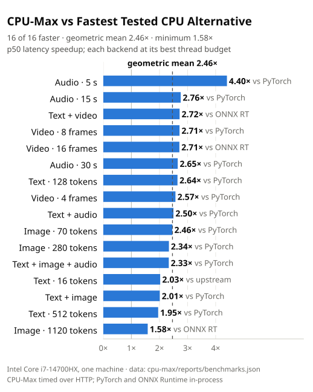
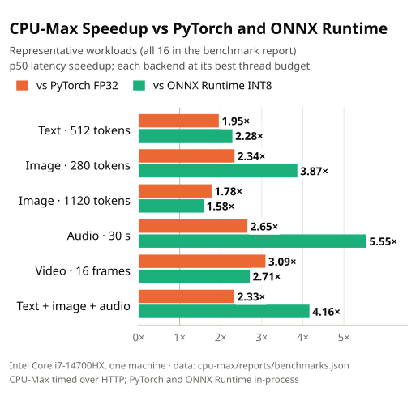
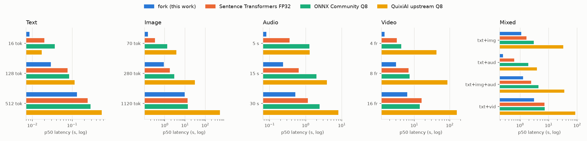
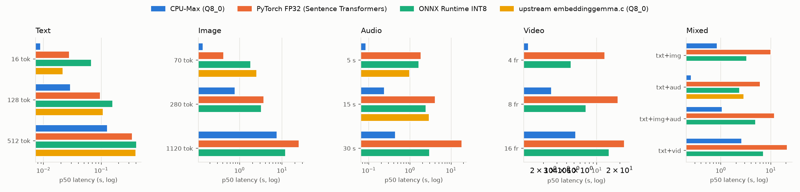
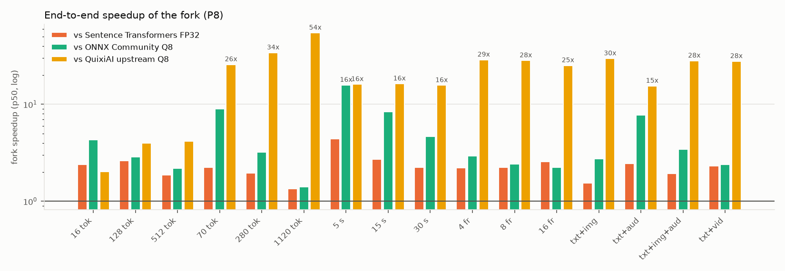
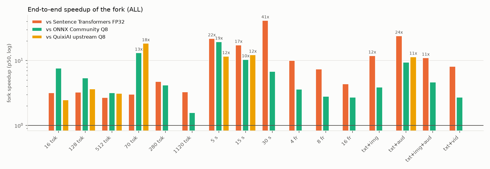
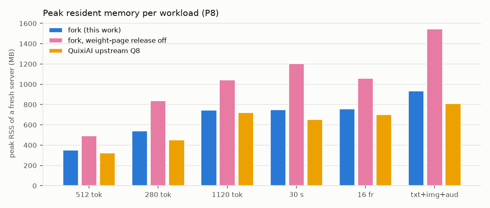
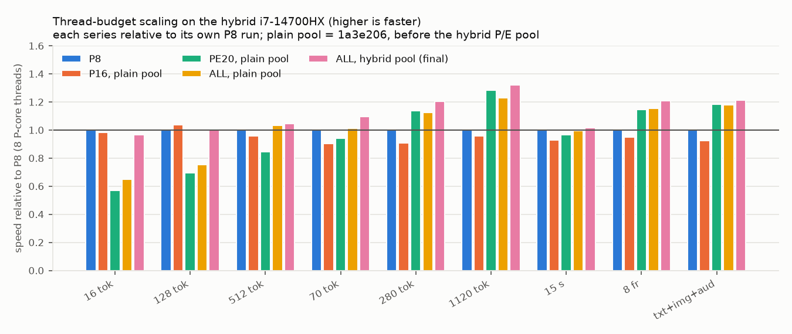
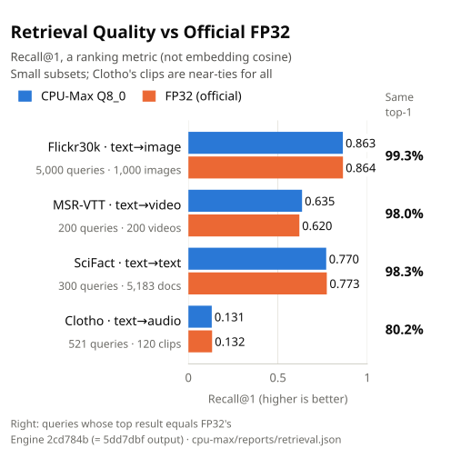

# CPU-Max benchmark report

Full results behind the [README](../../README.md): every table below is
generated from the JSON files in this directory by
`scripts/render_results.py`, the charts by `scripts/plot_bench.py`, from raw
per-run data in [`raw/`](raw/). Which raw run feeds which table, the run
policies and the known anomalies are listed in [`README.md`](README.md) next to
this file.

**Scope.** One machine: Intel Core i7-14700HX (8 P-cores with SMT + 12
E-cores, 28 hardware threads, AVX2 + AVX-VNNI, no AVX-512/AMX), 16 GB,
Ubuntu 24.04, GCC 13.3, CPU only. Engine commit `5dd7dbf`. The results have
not been reproduced on other hardware. They compare the tested backends on
this machine; they say nothing about other CPUs, models or runtimes.

## Charts

| | |
|---|---|
|  |  |
|  |  |
|  |  |
|  |  |
|  | |

The values plotted in the README charts are listed in
[`plots/readme/chart_data.csv`](plots/readme/chart_data.csv).

## Method

* **Backends and precision.** CPU-Max: the Q8_0 GGUF model, Q8_0 weights and
  Q8_0 activations in its integer matrix multiplications, fp32 elsewhere.
  Upstream `embeddinggemma.c` at `d8f9e33`: same model files and precision.
  PyTorch FP32: Sentence Transformers 6.1 / Transformers 5.20 / PyTorch 2.14
  (CPU build) on the official FP32 checkpoint. ONNX Runtime 1.23: the ONNX
  Community INT8 export. Part of CPU-Max's advantage over PyTorch is integer
  vs floating-point arithmetic; the comparison with ONNX Runtime INT8 is not
  affected by that.
* **Timing boundary.** CPU-Max and upstream are measured end to end over HTTP
  (JSON request with base64 media, server-side decoding, response); PyTorch
  and ONNX Runtime in-process (processor + model call), which excludes request
  handling and favours them.
* **Thread budgets.** P8 = 8 threads pinned to one hardware thread per
  P-core (CPUs 0,2,…,14); ALL = 28 threads on every hardware thread. Every
  backend is measured at both. The headline (geometric mean 2.46x) compares
  each backend at its own faster budget per workload; same-budget figures
  are given under the tables.
* **Inputs.** 16 workloads — text of 16/128/512 tokens; images at 70/280/1120
  vision tokens (336x480, 672x960, 1344x1920); audio of 5/15/30 s; video of
  4/8/16 frames at 1 fps (480x672); and four mixed inputs — pre-decoded at
  the official processor's geometry so every backend gets identical pixels
  and samples (`scripts/make_fixtures.py`).
* **Statistic.** Warm latency: 1 warm-up, then 3 to 10 measured repetitions
  per workload (30 s budget). Tables show p50 with p95 in parentheses.
* **Quiet-host guard.** The machine is a shared workstation. Before each
  workload the harness waits (up to 180 s) until other processes use at most
  1.5 CPU cores, measured from `/proc/stat` while the backend is idle, and
  records the CPU used by other processes during the measurement
  (`foreign_cores` in the raw JSON). An earlier full run that overlapped
  other services is kept, with the reason, in [`raw/excluded/`](raw/excluded/)
  and is used by nothing.
* **Run policy.** CPU-Max: exactly one guarded run per budget. Baselines
  (PyTorch, ONNX Runtime, upstream): the better of two runs per workload,
  which can only favour them. Throughput: the range over two runs.
* **Variability.** At P8 CPU-Max's p95 is within 12% of its p50 on every
  workload. At 28 threads it showed occasional slow repetitions on video
  (4 frames: p95 3.6x p50; text + video: 2.6x) with no measurable load from
  other processes — not root-caused. PyTorch at 28 threads has much larger
  tails (up to 19x).

## Results

<!-- RESULTS:BEGIN -->
<!-- generated by cpu-max/scripts/render_results.py --fork fork_5dd7dbf; do not edit by hand -->

**Warm latency, ms, p50 (p95) — 8 threads on the 8 P-cores (P8)**

| workload | CPU-Max (Q8_0) | PyTorch FP32 (Sentence Transformers) | ONNX Runtime INT8 | upstream embeddinggemma.c (Q8_0) | fork vs fastest other, same budget (p50) |
|---|---:|---:|---:|---:|---:|
| text, 16 tokens | **8.6 (9.6)** | 20.4 (21.0) | 36.8 (37.4) | 17.4 (17.6) | 2.03x |
| text, 128 tokens | **29.5 (29.7)** | 77.5 (78.5) | 84.7 (91.9) | 117 (128) | 2.63x |
| text, 512 tokens | **134 (136)** | 250 (253) | 292 (295) | 556 (565) | 1.87x |
| image, 70 tokens (336x480) | **152 (154)** | 341 (342) | 1,368 (1,525) | 3,909 (4,241) | 2.24x |
| image, 280 tokens (672x960) | **942 (947)** | 1,829 (1,840) | 3,028 (3,139) | 32,082 (32,215) | 1.94x |
| image, 1120 tokens (1344x1920) | **10,140 (10,562)** | 13,646 (13,676) | 14,321 (14,327) | 552,466 (554,508) | 1.35x |
| audio, 5 s | **82.1 (83.1)** | 361 (406) | 1,297 (1,483) | 1,320 (1,330) | 4.40x |
| audio, 15 s | **241 (243)** | 654 (734) | 2,014 (2,115) | 3,935 (4,244) | 2.71x |
| audio, 30 s | **523 (524)** | 1,169 (1,490) | 2,448 (2,504) | 8,202 (8,603) | 2.24x |
| video, 4 frames | **1,482 (1,496)** | 3,265 (3,309) | 4,332 (4,428) | 42,652 (46,146) | 2.20x |
| video, 8 frames | **3,096 (3,145)** | 6,946 (6,960) | 7,465 (7,507) | 87,577 (95,909) | 2.24x |
| video, 16 frames | **6,405 (6,422)** | 16,418 (17,979) | 14,392 (14,494) | 161,199 (170,245) | 2.25x |
| text + image | **1,114 (1,178)** | 1,707 (1,716) | 3,050 (3,235) | 33,015 (34,190) | 1.53x |
| text + audio | **258 (260)** | 635 (689) | 1,997 (2,055) | 3,991 (4,317) | 2.46x |
| text + image + audio | **1,295 (1,308)** | 2,495 (2,604) | 4,454 (4,485) | 36,394 (37,071) | 1.93x |
| text + video | **3,137 (3,289)** | 7,276 (9,353) | 7,519 (7,822) | 87,103 (87,788) | 2.32x |

Same-budget geometric mean (P8, 16 workloads): 2.20x over the fastest other backend (minimum 1.35x).

**Warm latency, ms, p50 (p95) — all 28 hardware threads (ALL)**

| workload | CPU-Max (Q8_0) | PyTorch FP32 (Sentence Transformers) | ONNX Runtime INT8 | upstream embeddinggemma.c (Q8_0) | fork vs fastest other, same budget (p50) |
|---|---:|---:|---:|---:|---:|
| text, 16 tokens | **8.9 (12.7)** | 28.2 (34.0) | 68.0 (73.3) | 21.9 (24.1) | 2.47x |
| text, 128 tokens | **29.3 (29.7)** | 96.0 (1,849) | 158 (256) | 108 (111) | 3.27x |
| text, 512 tokens | **128 (130)** | 344 (1,976) | 408 (499) | 398 (434) | 2.69x |
| image, 70 tokens (336x480) | **139 (152)** | 419 (4,657) | 1,824 (2,036) | 2,548 (2,572) | 3.03x |
| image, 280 tokens (672x960) | **783 (826)** | 3,709 (5,216) | 3,294 (3,530) | – | 4.21x |
| image, 1120 tokens (1344x1920) | **7,678 (7,823)** | 25,366 (27,197) | 12,142 (13,083) | – | 1.58x |
| audio, 5 s | **84.6 (86.4)** | 1,852 (3,558) | 1,648 (2,021) | 987 (1,002) | 11.66x |
| audio, 15 s | **237 (251)** | 4,126 (8,433) | 2,470 (2,698) | 2,911 (3,032) | 10.40x |
| audio, 30 s | **441 (461)** | 18,259 (18,894) | 2,995 (3,236) | – | 6.79x |
| video, 4 frames | **1,271 (4,569)** | 12,703 (14,208) | 4,579 (5,060) | – | 3.60x |
| video, 8 frames | **2,560 (3,404)** | 18,955 (19,005) | 7,219 (7,504) | – | 2.82x |
| video, 16 frames | **5,313 (5,337)** | 23,168 (24,622) | 14,481 (15,445) | – | 2.73x |
| text + image | **849 (872)** | 10,109 (15,189) | 3,314 (3,537) | – | 3.90x |
| text + audio | **254 (271)** | 6,109 (10,606) | 2,384 (2,506) | 2,901 (2,918) | 9.37x |
| text + image + audio | **1,070 (1,098)** | 11,795 (12,890) | 4,987 (5,310) | – | 4.66x |
| text + video | **2,629 (6,952)** | 21,358 (21,682) | 7,142 (7,259) | – | 2.72x |

Same-budget geometric mean (ALL, 16 workloads): 4.02x over the fastest other backend (minimum 1.58x).

**Best thread budget per backend (P8 or ALL), p50 ms**

| workload | CPU-Max (Q8_0) | PyTorch FP32 (Sentence Transformers) | ONNX Runtime INT8 | upstream embeddinggemma.c (Q8_0) | fork vs fastest other |
|---|---:|---:|---:|---:|---:|
| text, 16 tokens | **8.6 (P8)** | 20.4 (P8) | 36.8 (P8) | 17.4 (P8) | 2.03x vs upstream |
| text, 128 tokens | **29.3 (ALL)** | 77.5 (P8) | 84.7 (P8) | 108 (ALL) | 2.64x vs PyTorch FP32 |
| text, 512 tokens | **128 (ALL)** | 250 (P8) | 292 (P8) | 398 (ALL) | 1.95x vs PyTorch FP32 |
| image, 70 tokens (336x480) | **139 (ALL)** | 341 (P8) | 1,368 (P8) | 2,548 (ALL) | 2.46x vs PyTorch FP32 |
| image, 280 tokens (672x960) | **783 (ALL)** | 1,829 (P8) | 3,028 (P8) | 32,082 (P8) | 2.34x vs PyTorch FP32 |
| image, 1120 tokens (1344x1920) | **7,678 (ALL)** | 13,646 (P8) | 12,142 (ALL) | 552,466 (P8) | 1.58x vs ONNX Runtime INT8 |
| audio, 5 s | **82.1 (P8)** | 361 (P8) | 1,297 (P8) | 987 (ALL) | 4.40x vs PyTorch FP32 |
| audio, 15 s | **237 (ALL)** | 654 (P8) | 2,014 (P8) | 2,911 (ALL) | 2.76x vs PyTorch FP32 |
| audio, 30 s | **441 (ALL)** | 1,169 (P8) | 2,448 (P8) | 8,202 (P8) | 2.65x vs PyTorch FP32 |
| video, 4 frames | **1,271 (ALL)** | 3,265 (P8) | 4,332 (P8) | 42,652 (P8) | 2.57x vs PyTorch FP32 |
| video, 8 frames | **2,560 (ALL)** | 6,946 (P8) | 7,219 (ALL) | 87,577 (P8) | 2.71x vs PyTorch FP32 |
| video, 16 frames | **5,313 (ALL)** | 16,418 (P8) | 14,392 (P8) | 161,199 (P8) | 2.71x vs ONNX Runtime INT8 |
| text + image | **849 (ALL)** | 1,707 (P8) | 3,050 (P8) | 33,015 (P8) | 2.01x vs PyTorch FP32 |
| text + audio | **254 (ALL)** | 635 (P8) | 1,997 (P8) | 2,901 (ALL) | 2.50x vs PyTorch FP32 |
| text + image + audio | **1,070 (ALL)** | 2,495 (P8) | 4,454 (P8) | 36,394 (P8) | 2.33x vs PyTorch FP32 |
| text + video | **2,629 (ALL)** | 7,276 (P8) | 7,142 (ALL) | 87,103 (P8) | 2.72x vs ONNX Runtime INT8 |

Geometric mean over the 16 workloads: **2.46x** faster than the fastest other tested backend for each workload, each backend at its best budget (minimum 1.58x).

**Final-embedding cosine vs the official Sentence Transformers FP32 model (same inputs)**

| workload | fork | fork_28t | onnx_q8 | upstream | upstream_no_timestamps | st_fp32_run1 |
|---|---:|---:|---:|---:|---:|---:|
| text, 16 tokens | 0.99980 | 0.99980 | 0.99993 | 0.99981 | – | 1.00000 |
| text, 128 tokens | 0.99974 | 0.99974 | 0.99989 | 0.99973 | – | 1.00000 |
| text, 512 tokens | 0.99977 | 0.99977 | 0.99993 | 0.99981 | – | 1.00000 |
| image, 70 tokens (336x480) | 0.99964 | 0.99964 | 0.99850 | 0.99867 | – | 1.00000 |
| image, 280 tokens (672x960) | 0.99978 | 0.99978 | 0.99962 | 0.99954 | – | 1.00000 |
| image, 1120 tokens (1344x1920) | 0.99986 | 0.99986 | 0.99928 | 0.99963 | – | 1.00000 |
| audio, 5 s | 0.99914 | 0.99914 | 0.99984 | 0.99856 | – | 1.00000 |
| audio, 15 s | 0.99946 | 0.99946 | 0.99985 | 0.99895 | – | 1.00000 |
| audio, 30 s | 0.99932 | 0.99932 | 0.99981 | 0.99883 | – | 1.00000 |
| video, 4 frames | 0.99989 | 0.99989 | 0.99850 | 0.87563 | 0.99979 | 1.00000 |
| video, 8 frames | 0.99989 | 0.99989 | 0.99885 | 0.94145 | 0.99983 | 1.00000 |
| video, 16 frames | 0.99987 | 0.99987 | 0.99871 | 0.96294 | – | 1.00000 |
| text + image | 0.99970 | 0.99970 | 0.99932 | 0.99956 | – | 1.00000 |
| text + audio | 0.99984 | 0.99984 | 0.99992 | 0.99980 | – | 1.00000 |
| text + image + audio | 0.99973 | 0.99973 | 0.99929 | 0.99955 | – | 1.00000 |
| text + video | 0.99982 | 0.99982 | 0.99884 | 0.95552 | 0.99977 | 1.00000 |
| **min / mean** | **0.99914** / 0.99970 | **0.99914** / 0.99970 | **0.99850** / 0.99938 | **0.87563** / 0.98300 | **0.99977** / 0.99980 | **1.00000** / 1.00000 |

**Retrieval quality (higher is better; `top1 agr.` = share of queries whose top hit equals the FP32 model's)**

| task | backend | R@1 | R@5 | R@10 | nDCG@10 | top-10 overlap vs FP32 | top1 agr. vs FP32 |
|---|---|---:|---:|---:|---:|---:|---:|
| flickr (5000 q / 1000 docs) | fork_official | 0.8630 | 0.9756 | 0.9872 | 0.9307 | 0.9782 | 0.9928 |
| flickr (5000 q / 1000 docs) | fork_upstream_semantics | 0.8634 | 0.9748 | 0.9876 | 0.9307 | 0.9706 | 0.9904 |
| flickr (5000 q / 1000 docs) | st_fp32 | 0.8636 | 0.9750 | 0.9872 | 0.9309 | 1.0000 | 1.0000 |
| clotho (521 q / 120 docs) | fork_official | 0.1305 | 0.3781 | 0.5298 | 0.3032 | 0.9056 | 0.8023 |
| clotho (521 q / 120 docs) | fork_upstream_semantics | 0.1344 | 0.3724 | 0.5605 | 0.3133 | 0.8902 | 0.7850 |
| clotho (521 q / 120 docs) | quixi_upstream | 0.1305 | 0.3551 | 0.5662 | 0.3120 | 0.8885 | 0.8100 |
| clotho (521 q / 120 docs) | st_fp32 | 0.1324 | 0.3743 | 0.5336 | 0.3025 | 1.0000 | 1.0000 |
| msrvtt (200 q / 200 docs) | fork_official | 0.6350 | 0.8450 | 0.8850 | 0.7623 | 0.9760 | 0.9800 |
| msrvtt (200 q / 200 docs) | fork_upstream_semantics | 0.6100 | 0.8400 | 0.8850 | 0.7465 | 0.6745 | 0.7500 |
| msrvtt (200 q / 200 docs) | st_fp32 | 0.6200 | 0.8550 | 0.8850 | 0.7564 | 1.0000 | 1.0000 |
| scifact (300 q / 5183 docs) | fork_official | 0.7700 | 0.9100 | 0.9467 | 0.8521 | 0.9790 | 0.9833 |
| scifact (300 q / 5183 docs) | fork_upstream_semantics | 0.7700 | 0.9100 | 0.9467 | 0.8521 | 0.9790 | 0.9833 |
| scifact (300 q / 5183 docs) | quixi_upstream | 0.7733 | 0.9100 | 0.9500 | 0.8539 | 0.9780 | 0.9833 |
| scifact (300 q / 5183 docs) | st_fp32 | 0.7733 | 0.9067 | 0.9467 | 0.8514 | 1.0000 | 1.0000 |

**Peak resident memory of a fresh server per workload (MB, P8)**

| backend | t512 | i280 | i1120 | a30 | v16 | m_tia |
|---|---:|---:|---:|---:|---:|---:|
| fork_5dd7dbf | 350 | 539 | 746 | 748 | 759 | 936 |
| fork_5dd7dbf_norelease | 494 | 838 | 1,044 | 1,203 | 1,057 | 1,546 |
| fork_5dd7dbf_prepack | 850 | 875 | 1,084 | 915 | 1,099 | 941 |
| quixi_upstream | 322 | 454 | 720 | 654 | 700 | 808 |

**Throughput with concurrent clients (requests/s, distinct inputs; range over the runs)**

| backend | budget | workload | clients | req/s |
|---|---|---|---:|---:|
| fork_5dd7dbf | ALL | a15 | 2 | 2.63-4.23 |
| fork_5dd7dbf | P8 | a15 | 2 | 4.04-4.06 |
| quixi_upstream | P8 | a15 | 2 | 0.24-0.25 |
| fork_5dd7dbf | ALL | i70 | 2 | 5.90-6.95 |
| fork_5dd7dbf | P8 | i70 | 2 | 6.11-6.26 |
| quixi_upstream | P8 | i70 | 2 | 0.24-0.25 |
| fork_5dd7dbf | ALL | t128 | 4 | 34.65-35.38 |
| fork_5dd7dbf | P8 | t128 | 4 | 33.19-36.22 |
| quixi_upstream | P8 | t128 | 4 | 7.79-8.18 |
| fork_5dd7dbf | ALL | t128 | 16 | 45.52-74.95 |
| fork_5dd7dbf | P8 | t128 | 16 | 73.18-74.83 |
| quixi_upstream | P8 | t128 | 16 | 16.85-17.39 |
| fork_5dd7dbf | ALL | t16 | 4 | 168.82-168.94 |
| fork_5dd7dbf | P8 | t16 | 4 | 151.27-157.16 |
| quixi_upstream | P8 | t16 | 4 | 61.71-63.70 |
| fork_5dd7dbf | ALL | t16 | 16 | 451.54-452.90 |
| fork_5dd7dbf | P8 | t16 | 16 | 410.25-472.45 |
| quixi_upstream | P8 | t16 | 16 | 119.41-138.46 |

**Weight precision vs quality** (FP32 model with its linear weights rounded per 32-block; cosine of the final embedding against the unrounded model)

| scheme | text | vision | audio | min cosine | worst workload |
|---|---|---|---|---:|---|
| q8_all | q8 | q8 | q8 | 0.99932 | a5 |
| q4_text | q4 | q8 | q8 | 0.96436 | t128 |
| q4_vision | q8 | q4 | q8 | 0.98767 | i70 |
| q4_audio | q8 | q8 | q4 | 0.93288 | a5 |
| q4_all | q4 | q4 | q4 | 0.91563 | a15 |

<!-- RESULTS:END -->

## Quality notes

* **Embeddings** are near-FP32, not identical: cosine ≥ 0.99914 (mean
  0.99970) to the official FP32 model on the 16 workloads.
* **Retrieval** (`retrieval.json`): CPU-Max's top-1 result equals FP32's for
  99.3% of Flickr30k, 98.0% of MSR-VTT and 98.3% of SciFact queries, but only
  80.2% of Clotho (audio) queries. Clotho's 120 clips are near-ties (R@1 ≈
  0.13 for every backend; upstream agrees with FP32 on 81%), so its rankings
  flip on tiny score differences — audio ranking stability is the weakest
  measured point. The sets are small subsets (Flickr30k 1k test with 5,000
  captions; 200 MSR-VTT 1k-A videos; 120 Clotho clips; SciFact with 300
  queries and 5,183 documents): they show no measurable loss on these sets,
  not model-wide guarantees. Recall@1 is a ranking metric and is reported
  separately from embedding cosine.
* **Weight precision** (`quant_study.json`): rounding the FP32 model's weights
  to Q8_0 costs at most 0.0007 cosine; 4-bit weights cost 0.036 (text) to
  0.084 (all towers).

## Compatibility with existing vector indexes

Upstream deviates from the official model in three places (QuickGELU in the
vision MLP because the GGUF lacks the activation flag, the log-mel floor,
and `MM:SS` timestamp text before every video frame); CPU-Max follows the
official model by default. Upstream's video embeddings are as far as cosine
0.876 from the official model's (CPU-Max: ≥ 0.9998), and with upstream
semantics only 75% of MSR-VTT top-1 results agree with FP32's. **Do not mix
CPU-Max and upstream embeddings of images, audio or video in one index**:
re-embed, or run CPU-Max with `EI_GEMMA2_SEMANTICS=upstream`, which
reproduces upstream's embeddings to cosine ≥ 0.9992. Text embeddings are
unaffected.

## Limitations

* One machine. CPUs with AVX-512 VNNI use upstream's repacked GEMM for the
  integer GEMMs; CPUs without AVX-VNNI use upstream's AVX2 kernels; ARM64
  and macOS builds use upstream's portable/NEON paths. None of these was
  measured; the non-x86 builds are compiled in CI only.
* Media requests are serialized on the CPU backend (each uses every core);
  text requests are interleaved between tower layers.
* Peak RSS is 4-19% above upstream's per workload (repacked weights are
  anonymous memory where upstream reads the mapped GGUF). Over a whole
  benchmark run in one process: CPU-Max ~1.4 GB, PyTorch FP32 ~4.8 GB, ONNX
  Runtime 4.8-5.3 GB (`peak_rss_mb` of the `final_*` runs).
* Remaining bottlenecks, ranked: [`bottlenecks.md`](bottlenecks.md).

## Reproduce

The suite lives in `cpu-max/` (Python 3.12 via [uv](https://docs.astral.sh/uv/),
CPU-only PyTorch; `ffmpeg` and `unzip` on the system). Downloads are pinned
to the revisions used here.

```sh
cd cpu-max
uv sync                                    # PyTorch (CPU), Sentence Transformers, ONNX Runtime
scripts/download_assets.sh                 # models + datasets (~5 GB; MSR-VTT archive 2.2 GB)
scripts/setup_upstream.sh                  # unmodified upstream d8f9e33 as a git worktree, built
(cd .. && make build/embeddinggemma build/test_gemma2_media build/test_gemma2_vnni256 \
           build/test_gemma2_attn build/bench_gemma2_cpu)
.venv/bin/python scripts/hw_detect.py      # reports/hardware.json
.venv/bin/python scripts/make_fixtures.py  # bench/fixtures/ (identical inputs for every backend)

scripts/run_final_matrix.sh fork fork_all st onnx onnx_all_media upstream_fast memory throughput tput_all
scripts/run_upstream_P8.sh                 # upstream's scalar media towers at P8 (about an hour)
.venv/bin/python scripts/summarize_bench.py --best-of reports/raw/final_fork_<commit>_{P8_t8,ALL_t28}.json \
    reports/raw/final_st_fp32_*.json reports/raw/final_onnx_q8_*.json reports/raw/m1_upstream_P8_t8*.json \
    reports/raw/final_upstream_{P8_t8_fast,ALL_t28}.json --speedup-vs quixi_upstream --out reports/benchmarks
.venv/bin/python scripts/validate_embeddings.py --ref reports/raw/final_st_fp32_P8_t8.npz \
    --run fork=reports/raw/final_fork_<commit>_P8_t8.npz --out reports/quality_embeddings
.venv/bin/python scripts/prepare_retrieval_data.py && scripts/run_retrieval.sh   # about 3 hours
.venv/bin/python scripts/quant_study.py
scripts/profile_final.sh P8                # per-stage profiles
.venv/bin/python scripts/render_results.py --fork fork_<commit> --inject reports/BENCHMARKS.md
.venv/bin/python scripts/plot_bench.py --fork fork_<commit> --budget P8      # report plots
.venv/bin/python scripts/plot_bench.py --fork fork_<commit> --readme         # README charts
```

The machine must be otherwise idle; `bench/run_bench.py --quiet-cores`
waits for that and records the foreign load per measurement. The budgets
(`P8`, `ALL`, …) are CPU lists for the i7-14700HX in `bench/run_bench.py`
(`BUDGETS`); adapt them to other CPUs.

## Further reading

* [`optimization_log.md`](optimization_log.md) — every optimization attempt,
  kept or rejected, with its measurements
* [`bottlenecks.md`](bottlenecks.md) — ranked bottlenecks before and after
* [`../../CPU_MAX.md`](../../CPU_MAX.md) — engine changes by commit, flags and tests
* [`README.md`](README.md) — artifact provenance, policies, known anomalies
